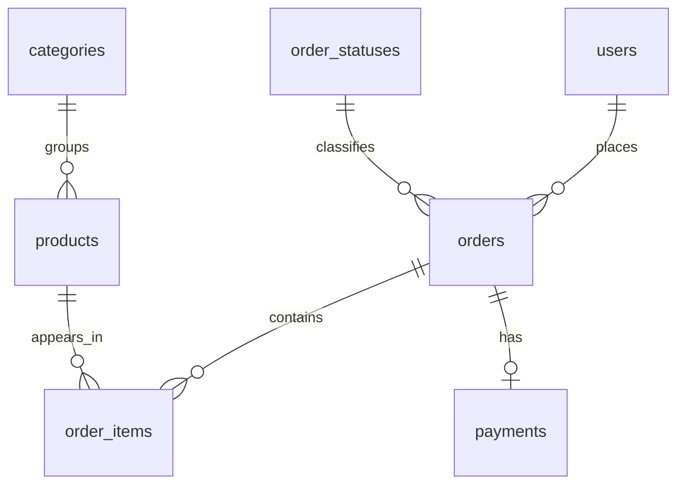

> Historical explanatory notes adapted from the source exercise. Use README and docs/VALIDATION.md for current portfolio status. SQL paths below are relative to the project root.

# Giải thích bài thực hành SQL Server — E-commerce

## 1. Mục tiêu và cách làm

Mình làm bài theo trình tự: **nạp dữ liệu → xem bảng → kiểm tra chất lượng → định nghĩa tập đơn → phân tích thời gian → sản phẩm → khách hàng → đối chiếu**. Phần SQL tập trung `SELECT`, `WHERE`, `ORDER BY`, `GROUP BY`, `HAVING`, `CASE`, `INNER JOIN`, `LEFT JOIN` và vài subquery nhỏ; chưa cần CTE, window functions hoặc machine learning.

Câu hỏi chính: giá trị bán hàng phân bố thế nào theo tháng/quý; đơn nào có giá trị cao; sản phẩm, danh mục và khách hàng nào đóng góp nhiều trong dữ liệu mẫu?

Đây là **descriptive analysis** — phân tích mô tả. Nguồn tự ghi là dữ liệu giả lập, nên kết quả phục vụ luyện SQL và kiểm tra tư duy KPI, không dùng để đề xuất chiến lược cho một doanh nghiệp có thật.

## 2. Chạy file nào trước?

Database **`EcommerceSalesPortfolio` đã được nạp và kiểm tra trên máy của bạn ngày 16/10/2026**. Mở SSMS, kết nối `localhost` bằng Windows Authentication, Refresh Databases rồi bắt đầu với **`sql/02_thuc_hanh.sql`**.

Nếu tái lập từ đầu ở database trống, mở **`sql/01_tao_va_nap.sql`** và Execute toàn bộ một lần. File chứa sẵn dữ liệu nguồn, tự tạo database, bảng và nạp mẫu. Không cần chạy thêm `ecommerce-sample-database-v1-sql-mssql.sql` vì sẽ tạo trùng bảng.

Sau khi thấy **31 bảng** và không có lỗi, mở **`sql/02_thuc_hanh.sql`** và chạy toàn bộ. Những lần học sau chỉ cần chạy từng truy vấn trong file 02. File 01 chặn nạp lại nếu database đã có bảng.

Phần nạp có transaction — nhóm thao tác được commit cùng nhau khi thành công, hoặc rollback khi lỗi runtime được bắt. Bạn chưa cần thuộc phần này để học phân tích; nó giúp tránh để lại bộ bảng chỉ nạp được một phần. Xem `README.md` để xử lý lỗi kết nối hoặc quyền.

## 3. Hiểu một dòng đại diện cho điều gì

Đây là **grain** của bảng. Xác định grain trước khi JOIN hoặc cộng tiền.

| Bảng | Một dòng đại diện cho | Khóa / quan hệ quan trọng |
|---|---|---|
| `users` | Một tài khoản khách hàng | `id` là primary key |
| `orders` | Một đơn hàng | `user_id` nối với `users.id` |
| `order_items` | Một dòng sản phẩm trong đơn | `order_id`, `product_id` nối tới đơn và sản phẩm |
| `products` | Một sản phẩm trong danh mục | `category_id` nối với `categories.id` |
| `categories` | Một danh mục | Có thể có danh mục cha |
| `order_statuses` | Một loại trạng thái đơn | `id` nối với `orders.order_status_id` |
| `payments` | Một bản ghi thanh toán | `order_id` là UNIQUE trong **nguồn này** |



Primary key (khóa chính) xác định một bản ghi. Foreign key (khóa ngoại) đảm bảo mã tham chiếu tồn tại. Khóa ngoại hợp lệ **không chứng minh logic nghiệp vụ hợp lý**: một đơn vẫn có thể tham chiếu đúng tài khoản nhưng mang ngày trước ngày tài khoản được tạo.

Trong nguồn này, một đơn có tối đa một payment vì `payments.order_id` là UNIQUE. Không áp dụng giả định này tự động cho database khác: hệ thống thật có thể có nhiều lần thử thanh toán hoặc trả góp trên cùng đơn.

## 4. Những gì đã kiểm tra trước khi phân tích

Nguồn có 31 bảng, 360 đơn, 1.000 dòng hàng, 400 sản phẩm, 70 tài khoản và 350 payment. Ngày đặt đơn quan sát từ **04/01/2021 16:50:15 đến 31/12/2025 08:44:12**. Đây là khoảng quan sát trong file, không chứng minh dữ liệu bao phủ mọi ngày hoặc đầy đủ mọi giao dịch.

| Kiểm tra độc lập bằng Python | Kết quả | Ý nghĩa và xử lý |
|---|---:|---|
| 36 quan hệ khóa ngoại | Không có tham chiếu mồ côi | Các mã nối bảng tồn tại |
| PK, cột UNIQUE, NOT NULL và giới hạn chuỗi | Đạt trên các giá trị đã đọc | Hỗ trợ kiểm tra khả năng nạp; không thay thế chạy SQL Server |
| `orders.subtotal` so với tổng `quantity * unit_price` | 0 đơn lệch | Có thể đối chiếu hàng từ dòng lên đơn |
| `orders.tax_amount` so với tổng thuế dòng hàng | 0 đơn lệch | Thành phần thuế khớp |
| Công thức tổng đơn | 0 đơn lệch | `total = subtotal - discount + tax + shipping` |
| `payments.amount` so với `orders.total` | 0 payment lệch | Khớp số tiền, chưa đảm bảo hợp lệ về trạng thái |
| Đơn trước ngày tạo tài khoản | 108 đơn | Vấn đề nhất quán thời gian; giữ nguyên, không dùng để suy luận tuổi khách hàng/cohort |
| Payment `completed` trên đơn `cancelled/refunded` | 56 đơn | Không suy ra doanh thu chỉ từ payment `completed` |
| Đơn không có payment | 10 đơn | Không thuộc tập đơn đủ điều kiện của bài |
| Đơn không có dòng hàng | 22 đơn | Chưa tự xóa; có thể vẫn có phí ship |
| Đơn đủ điều kiện không có dòng hàng | 15 đơn | Giữ trong số đơn và mẫu số AOV; giá trị hàng bằng 0 |
| Số lượng dòng hàng không dương / giá dòng hàng âm | 0 / 0 dòng | Không cần loại theo quy tắc này |

Không thay ngày tạo tài khoản bằng ngày đơn đầu tiên, không tự đổi trạng thái đơn và không giả định thiếu payment là chưa thanh toán thật. Những thao tác đó sẽ sửa dữ liệu theo suy đoán. Tách **raw data** và **analysis population** — tập bản ghi dùng để tính — giúp trình bày lựa chọn một cách minh bạch.

Tổng 360 đơn có trạng thái: `shipped` 152, `paid` 69, `delivered` 43, `pending` 36, `cancelled` 33, `refunded` 27. Có 338 payment `completed`, 8 `failed`, 4 `refunded`. Không cộng các số payment với số đơn như thể chúng là cùng một grain.

## 5. Định nghĩa KPI trước khi viết SQL

**Phạm vi mặc định:** toàn bộ giai đoạn của file mẫu, mọi khách hàng và sản phẩm. Một đơn đủ điều kiện có trạng thái **`paid`, `shipped` hoặc `delivered`**, đồng thời payment **`completed`**. Điều kiện được lưu trong `v_PracticeSalesOrders`, một view có **một dòng cho mỗi đơn**.

264 đơn có trạng thái nằm trong ba nhóm trên; sau điều kiện payment, còn **250 đơn**. Không loại thêm các đơn có ngày trước ngày tạo tài khoản: bài vẫn mô tả theo snapshot giả lập và ghi nhận lỗi này như một giới hạn. Không dùng tập này để phân tích vòng đời tài khoản.

| Chỉ tiêu | Tử số / mẫu số, phạm vi và đơn vị |
|---|---|
| `SalesValue` | Tổng `subtotal - discount_amount` của đơn đủ điều kiện; trước thuế và phí ship |
| `TotalBilled` | Tổng `orders.total` trên **cùng tập đơn**, gồm thuế/phí ship theo nguồn |
| `EligibleOrders` | Đếm đơn đủ điều kiện; không phải số dòng hàng |
| `AverageOrderSalesValue` | Tổng `SalesValue` / số đơn đủ điều kiện trong cùng kỳ; gồm cả đơn giá trị hàng bằng 0 |
| `ItemGrossValue` | Tổng `quantity * unit_price` từ dòng hàng thuộc đơn đủ điều kiện, trước giảm giá cấp đơn |
| `UnitsSold` | Tổng số lượng dòng hàng trên cùng tập đơn; chưa điều chỉnh lượng trả hàng |
| `RepeatCustomerPct` | Khách có ít nhất 2 đơn đủ điều kiện / khách có ít nhất 1 đơn đủ điều kiện × 100%, tính trên toàn kỳ |
| `CompletedPaymentAmount` | Tổng `payments.amount` với `status = completed`, phân kỳ theo `processed_at`; KPI thanh toán riêng |

Mọi giá trị tiền giữ nguyên **đơn vị tiền của dữ liệu mẫu**, chưa gắn nhãn USD/VND. Không có cost nên không tính lợi nhuận hoặc biên lợi nhuận.

Phân kỳ `SalesValue` theo **ngày đặt đơn `orders.created_at`**, còn thanh toán theo `payments.processed_at`. Trạng thái là trạng thái lưu trong file, không có lịch sử để tái tạo trạng thái tại từng tháng trong quá khứ. Ngày không có múi giờ được xác minh, nên không tự chuyển múi giờ.

`SalesValue` là chỉ tiêu thực hành gần với giá trị hàng sau giảm giá, **chưa phải doanh thu kế toán được ghi nhận**. Bài chưa trừ hoàn tiền một phần từ `order_returns`, chưa phân bổ giảm giá cấp đơn xuống sản phẩm và chưa đối soát chính sách ghi nhận. Vì vậy sản phẩm được xếp theo `ItemGrossValue`, không đặt tên là doanh thu thuần sản phẩm.

## 6. Giải thích các mục SQL

| Mục | Bạn đang thực hành | Cách hiểu kết quả |
|---|---|---|
| 01 | `SELECT`, `TOP`, `ORDER BY`, `COUNT`, `UNION ALL` | Xem mẫu, số dòng và khoảng ngày; không chọn `SELECT *` từ bảng khách để tránh hiển thị trường không cần thiết |
| 02 | `JOIN`, `GROUP BY` | Nối mã trạng thái với tên trạng thái rồi đếm số đơn |
| 03 | So sánh công thức; subquery nhóm theo đơn | Kiểm tra tiền ở cùng grain trước khi diễn giải |
| 04 | `INNER JOIN`, `LEFT JOIN`, `IS NULL`, `CASE` | Tìm thời gian bất hợp lý, thiếu payment/chi tiết; thống kê giá trị bất thường |
| 05 | `CREATE OR ALTER VIEW` và `WHERE` | Lưu điều kiện chung để các KPI dùng cùng phạm vi |
| 06 | `SUM`, `COUNT(DISTINCT ...)`, phép chia | Tổng quan và giá trị đơn bình quân; số dòng view phải bằng số OrderID distinct |
| 07 | `TOP`, lọc và sắp xếp | Top đơn giá trị hàng cao, không phải top khách hàng |
| 08 | `YEAR`, `MONTH`, `GROUP BY` | 60 hàng tháng; luôn nhóm cả năm và tháng |
| 09 | `DATEPART(QUARTER, ...)` | 20 hàng quý; Q1 tháng 1–3, Q2 tháng 4–6, Q3 tháng 7–9, Q4 tháng 10–12 |
| 10 | Tổng hợp năm | Mô tả tổng trong mẫu, không diễn giải như tăng trưởng doanh nghiệp thật |
| 11 | JOIN dòng hàng–đơn–sản phẩm | Top sản phẩm theo giá trị hàng trước giảm giá cấp đơn |
| 12 | Thay tiêu chí `ORDER BY` | Top theo số lượng có thể khác top theo giá trị |
| 13 | JOIN thêm danh mục | Mã/tên danh mục và giá trị hàng đóng góp |
| 14 | JOIN khách–đơn | Top khách theo tổng giá trị các đơn đủ điều kiện, không cộng lặp theo chi tiết |
| 15 | `HAVING COUNT(*) >= 2` | Khách mua lặp trong toàn giai đoạn; không phải retention theo tháng |
| 16 | `LEFT JOIN ... WHERE ... IS NULL` | Tài khoản không có đơn đủ điều kiện; vẫn có thể có đơn bị hủy hoặc pending |
| 17 | Lọc payment và nhóm ngày thanh toán | Chỉ tiêu khác SalesValue về thời gian, phạm vi và thành phần tiền |
| 18 | Đối chiếu đúng/sai khi JOIN | Nhìn thấy tác động nhân dòng khi cộng tiền cấp đơn trên bảng chi tiết |

`WHERE` lọc bản ghi **trước** khi nhóm. `HAVING` lọc **nhóm sau** khi tính tổng/đếm. Ví dụ chọn các đơn có trạng thái hợp lệ bằng `WHERE`; chọn khách có ít nhất hai đơn bằng `HAVING`.

`NULLIF(COUNT(*), 0)` tránh lỗi chia cho 0 nếu tập lọc rỗng. `COUNT(*)` đếm dòng; `COUNT(column)` chỉ đếm dòng có cột đó khác NULL. Bài dùng số thập phân `decimal` có sẵn trong nguồn, không chuyển tiền sang `float`.

## 7. Lỗi JOIN quan trọng nhất cần hiểu

Ví dụ **giả lập**: đơn số 1 có `total = 100` và hai dòng sản phẩm. Sau JOIN `orders` với `order_items`, giá trị `100` xuất hiện hai lần. `SUM(orders.total)` lúc này thành `200`, dù chỉ có một đơn.

Cách làm đúng tùy câu hỏi:

- Tính tổng tiền đơn: cộng trên `orders` hoặc view có một dòng/đơn.
- Tính giá trị sản phẩm: cộng `order_items.quantity * order_items.unit_price` ở cấp dòng.
- So sánh chi tiết với tổng đơn: `GROUP BY order_id` chi tiết trước, rồi JOIN tập đã tổng hợp về đơn.

Không dùng `SUM(DISTINCT total)` để sửa. Nếu hai đơn hợp lệ cùng có total 100, `SUM(DISTINCT total)` chỉ giữ một giá trị 100 và làm mất tiền. `COUNT(DISTINCT order_id)` có thể sửa **số đơn**, nhưng không tự sửa được **tổng tiền bị lặp**.

`products.price` là giá trong danh mục hiện tại; khi tính giá trị giao dịch phải dùng `order_items.unit_price`, là giá được lưu trên dòng đơn.

## 8. Đáp án tham khảo để đối chiếu

Các kết quả sau được tính độc lập bằng Python khi đọc giá trị `INSERT` và **đã đối chiếu thành công với truy vấn chạy trên SQL Server 2022**. Kết quả thực tế được xuất trong `outputs/sql_server/`; danh sách truy vấn và file nằm ở `INDEX.md` trong thư mục đó.

| Chỉ tiêu trên tập đủ điều kiện | Kết quả |
|---|---:|
| Số đơn | 250 |
| Khách có ít nhất một đơn | 66 |
| Khách có ít nhất hai đơn | 56 |
| Tỷ lệ khách mua lặp trong toàn kỳ | 84,85% |
| Tổng giá trị hàng trước giảm giá cấp đơn | 61.632,94 |
| Tổng giảm giá cấp đơn | 591,81 |
| `SalesValue` | 61.041,13 |
| Thuế | 4.930,54 |
| Phí vận chuyển | 4.346,04 |
| `TotalBilled` | 70.317,71 |
| `AverageOrderSalesValue` | 244,16452; khi trình bày làm tròn 244,16 |

**Đối chiếu tiền:**

```text
61.632,94 - 591,81 = 61.041,13
61.041,13 + 4.930,54 + 4.346,04 = 70.317,71
Tổng SalesValue theo tháng = theo quý = theo năm = theo khách = 61.041,13
Tổng ItemGrossValue theo sản phẩm = tổng subtotal tập đủ điều kiện = 61.632,94
```

Trong khi đó, tổng `orders.total` của **tất cả 360 đơn** là **101.846,66**, và tổng payment `completed` là **94.513,22**. Ba số 101.846,66 / 94.513,22 / 61.041,13 không cùng định nghĩa, nên khác nhau không tự chứng minh một phép tính sai.

| Năm đặt đơn | Đơn đủ điều kiện | `SalesValue` |
|---|---:|---:|
| 2021 | 40 | 11.063,52 |
| 2022 | 36 | 10.018,95 |
| 2023 | 44 | 9.496,48 |
| 2024 | 64 | 15.785,28 |
| 2025 | 66 | 14.676,90 |

Trong mẫu, năm 2024 có tổng cao nhất dù năm 2025 có nhiều đơn hơn. Đây là ví dụ để phân biệt **số đơn** và **giá trị mỗi đơn**; chưa giải thích nguyên nhân bằng chất lượng sản phẩm, khuyến mãi hoặc hành vi khách hàng.

Tháng có `SalesValue` cao nhất là **05/2025: 2.365,51**, từ 10 đơn đủ điều kiện. Sản phẩm đứng đầu theo giá trị hàng là **ProductID 4 — Practical Bamboo Table**, với **2.458,80**, 30 đơn vị trên 18 đơn khác nhau. Tên sản phẩm có thể trùng, nên truy vấn nhóm theo cả ID và tên.

66 khách có đơn đủ điều kiện trong 70 tài khoản nghĩa là có **4 tài khoản không có đơn đủ điều kiện**. Không tự gọi cả 4 tài khoản là “chưa từng mua hàng”: phải xét toàn bộ trạng thái để trả lời câu hỏi đó.

## 9. Những giới hạn cần nhớ

1. Dữ liệu giả lập và ít đơn mỗi tháng; không kết luận mùa vụ hoặc nguyên nhân thay đổi kinh doanh từ các tổng này.
2. Có 108 đơn trước ngày tạo tài khoản. Không dùng để tính thời gian từ đăng ký tới mua lần đầu hoặc cohort theo đăng ký nếu chưa xử lý được nguồn bất nhất.
3. 56 đơn hủy/hoàn tiền có payment completed. Bài loại theo trạng thái đơn và yêu cầu payment completed, không tự sửa trạng thái.
4. Có 15 đơn đủ điều kiện không có dòng hàng; chúng làm số đơn khác số đơn có sản phẩm. AOV trong bài giữ chúng ở mẫu số; muốn chỉ tính đơn có hàng phải đổi định nghĩa và tính lại toàn bộ chỉ tiêu liên quan.
5. Đã có bảng trả hàng nhưng chưa có phép đối soát hoàn tiền đầy đủ. Không gọi SalesValue là net revenue sau hoàn trả.
6. 56/66 là tỷ lệ mua lặp **toàn kỳ**, không phải retention rate, xác suất mua lại tương lai hay tỷ lệ mua lại trong 30 ngày. Các khách có thời gian quan sát khác nhau.
7. Nguồn không xác minh đồng tiền, doanh thu được ghi nhận hay cost; không quy đổi tiền hoặc bịa tác động kinh doanh.

## 10. Trạng thái kiểm thử và tái lập

Đã kiểm tra bằng Python: toàn bộ giá trị INSERT, khóa và giới hạn chuỗi, 36 FK, công thức tiền, tổng theo tháng/quý/khách/sản phẩm; bản loader sinh ra giữ cùng dữ liệu với nguồn. File nguồn có SHA-256 trong `outputs/audit.json`.

Hai file SQL đã được Microsoft ScriptDom kiểm tra: **0 lỗi cú pháp**. Sau đó đã chạy trực tiếp trên **SQL Server 2022 (16.0.1000.6)**: nạp đủ 31 bảng, kiểm tra 36 khóa ngoại được bật/trusted, tạo view và xuất 31 bảng kết quả từ bộ truy vấn.

Đối chiếu đạt: KPI tổng, 60 tháng, 20 quý, top 10 sản phẩm, top 10 khách hàng, khách mua lặp, tài khoản không có đơn đủ điều kiện, các số đếm EDA và ví dụ nhân tiền khi JOIN sai. Kết quả được lưu trong `outputs/sql_server/verification.json`, gồm hash file nguồn và hai file SQL để nhận biết thay đổi sau kiểm thử.

Lỗi SSPI trước đó đến từ việc phiên sandbox dùng tài khoản Windows khác. Kết nối bằng tài khoản Windows của người dùng ngoài sandbox đã thành công; không cần đổi cấu hình xác thực SQL Server. Kiểm thử được thực hiện qua .NET SQL client, không điều khiển trực tiếp giao diện SSMS. Hiện không còn phần thực thi bị chặn trong bộ bài này; các giới hạn dữ liệu giả lập ở mục 9 vẫn giữ nguyên.

Toàn bộ lời giải đã có trong file 02. Sau khi đọc hiểu, bạn có thể thử đổi mục 11 từ top giá trị sang top số lượng và đối chiếu mục 12; đây là bước luyện đọc SQL, không cần viết thêm công cụ.
